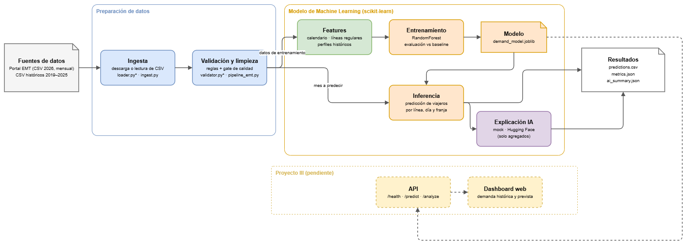

# Proyecto II — Automatización y predicción de demanda de viajeros EMT Madrid

## Objetivo

Automatizar el tratamiento de datos públicos de la Empresa Municipal de Transportes (EMT) de Madrid y entrenar un modelo de **regresión** que estime el número de viajeros de una línea de autobús en una fecha y franja horaria. La solución incluye ingesta, validación, métricas, entrenamiento con scikit-learn, inferencia y un cliente de IA con proveedor simulado (`mock`) o Hugging Face (`hf`).

**Motivación:** conocer la demanda esperada por línea y franja ayuda a planificar frecuencias y aglomeraciones, y a anticipar picos en festivos o fines de semana.

## Datos

- **Fuente:** EMT Madrid, [Demanda diaria de viajeros de autobús](https://datos.emtmadrid.es/dataset/demanda-diaria-viajeros-autobus).
- **Origen:** el portal publica un CSV con el año en curso (2026), que `ingest.py` descarga automáticamente, y un ZIP con los CSV históricos de 2019 a 2025, que se descomprimen en `proyecto_ii/data/raw/`.
- **Actualización:** la EMT publica actualizaciones periódicas del archivo del año en curso. La ingesta vuelve a descargarlo cuando se ejecuta sin `--input`.
- **Licencia y condiciones:** la ficha del dataset no especifica una licencia estándar concreta. La reutilización se rige por las condiciones generales de uso de datos abiertos de EMT Madrid, que permiten su utilización y transformación para fines comerciales y no comerciales, respetando las condiciones indicadas y citando la fuente.
- **Fecha de referencia del proyecto:** noviembre de 2026.

El CSV original de la EMT utiliza `;` como separador y tiene las columnas `Fecha`, `Linea`, `Franja` y `TotalViajeros`. El cargador de `proyecto_i/emt_app/loader.py` las transforma en:

| Campo interno | Significado |
| --- | --- |
| `date` | Fecha de la observación |
| `line` | Código de línea |
| `time_slot` | Franja `H00`–`H23` o `M00`–`M07` |
| `passengers` | Viajeros registrados en esa línea, fecha y franja |

La lectura del CSV descargado reutiliza los repositorios `EmtApiRepository` (descarga HTTP del **CSV**) y `CsvEmtRepository` (archivo o carpeta de CSV originales) del Proyecto I. Los tests sustituyen las llamadas de red por datos controlados.

### Validación y calidad

Se comprueban columnas, fecha, línea, franja horaria, viajeros enteros no negativos y duplicados por `(date, line, time_slot)`. Los resultados del pipeline incluyen `rows_in`, `rows_out`, `rows_dropped`, `error_rate`, número de líneas, fechas extremas y total de viajeros. Si la proporción de errores supera el umbral indicado, no se publica `clean.csv`.

## Instalación

Desde la **raíz del repositorio**:

```powershell
python -m venv .venv
.\.venv\Scripts\Activate.ps1
python -m pip install -r proyecto_ii/requirements.txt
```

Para usar Hugging Face (opcional), copiar `.env.example` de la raíz a `.env` y rellenar `HF_TOKEN`. `.env` está en `.gitignore` y no se sube a Git; sin token, todo funciona en modo `mock`.

## Ejecución paso a paso

Los comandos siguientes se ejecutan **desde la raíz del repositorio** y no requieren token de Hugging Face. Los resultados publicados en este README se obtuvieron con los CSV de 2024–2026 (segunda variante del paso 1). La primera variante, solo con 2026, sirve para probar la cadena sin descargar los históricos.

### 1. Ingesta de datos de entrenamiento

```powershell
python -m proyecto_ii.ingest --start-date 2026-01-01 --end-date 2026-08-31 --output proyecto_ii/data/emt_train.csv
```

Si se descomprimen los CSV históricos en `proyecto_ii/data/raw/`, `--input` los lee todos y `--start-date`/`--end-date` seleccionan el periodo. En este proyecto se usan los datos de 2024-01-01 a 2026-08-31: el modelo se ajusta con los días hasta 2026-02-17 y el resto se usa para evaluar.

```powershell
python -m proyecto_ii.ingest --start-date 2024-01-01 --end-date 2026-08-31 --input proyecto_ii/data/raw --output proyecto_ii/data/emt_train.csv
```

**Nota:** `--input` espera CSV **originales** de EMT (columnas `Fecha;Linea;Franja;TotalViajeros`), no los CSV normalizados por el propio proyecto. Sin `--input` se descarga el recurso de 2026; no se descargan automáticamente los ficheros históricos de 2019-2025.

### 2. Validación y limpieza

```powershell
python -m proyecto_ii.pipeline_emt --input proyecto_ii/data/emt_train.csv --output-dir proyecto_ii/output/clean_train --max-error-rate 0.05
```

Genera `clean.csv`, `metrics.json` y `run.log` si supera el control de calidad.

```powershell
python -m proyecto_ii.check_metrics --metrics proyecto_ii/output/clean_train/metrics.json --max-error-rate 0.05 --min-rows-out 7000
```

Códigos de salida: `0` = correcto; `1` = no se supera el control de calidad; `2` = error de entrada o métricas inválidas. La escritura de `clean.csv` y `metrics.json` sobrescribe el resultado previo, evitando duplicados por reejecución.

### 3. Entrenamiento

```powershell
python -m proyecto_ii.train --input proyecto_ii/output/clean_train/clean.csv --model proyecto_ii/models/demand_model.joblib --output-dir proyecto_ii/output/train
```

El entrenamiento guarda `proyecto_ii/models/demand_model.joblib`, las métricas en `proyecto_ii/output/train/metrics.json` y un `run.log`.

### 4. Datos de inferencia y predicciones

```powershell
python -m proyecto_ii.ingest --start-date 2026-09-01 --end-date 2026-09-30 --output proyecto_ii/data/emt_2026_09.csv
python -m proyecto_ii.pipeline_emt --input proyecto_ii/data/emt_2026_09.csv --output-dir proyecto_ii/output/clean_inference --max-error-rate 0.05
python -m proyecto_ii.predict --input proyecto_ii/output/clean_inference/clean.csv --model proyecto_ii/models/demand_model.joblib --output-dir proyecto_ii/output/inference --provider mock
```

La inferencia genera:

- `predictions.csv`: fecha, línea, franja, viajeros reales (si están disponibles), baseline y demanda estimada.
- `metrics.json`: filas procesadas, filas predichas, total de viajeros estimados y, si se conoce el valor real, MAE y MAE del baseline.
- `ai_summary.json`: texto, proveedor y tarea del cliente IA.
- `run.log`: eventos de la ejecución y posibles errores.

El modo `mock` devuelve un texto fijo y no realiza llamadas a servicios externos.

### 5. Automatización con Bash

```bash
bash proyecto_ii/scripts/run_cadena_emt.sh
```

Este script encadena descarga de 2026, preparación del conjunto de entrenamiento, limpieza, control de calidad, entrenamiento, inferencia con `mock` y notificación `output/LAST_OK.txt`. **Requiere disponer previamente de los CSV históricos de 2024 y 2025** dentro de `proyecto_ii/data/raw/`; solo el fichero de 2026 se descarga automáticamente. Los ficheros de salida y modelos no se versionan.

## Modelo y evaluación

Se utiliza `RandomForestRegressor` con `100` árboles, `min_samples_leaf=20`, `random_state=42` y un máximo de `200.000` filas muestreadas por árbol (`max_samples`), cuando el conjunto de entrenamiento es mayor.

El modelo utiliza ocho características:

- Calendario: `service_hour`, `day_of_week`, `day_type`, `is_holiday`, `month`, `day_of_year`.
- Perfiles de demanda histórica: `profile_line_slot` y `profile_line_slot_day_type`.

Las franjas `M00`–`M07` de servicios nocturnos se representan mediante horas de servicio posteriores a las `H00`–`H23`. Se excluyen del entrenamiento las líneas con menos de 30 días distintos de observaciones. Los festivos incluidos en `train.py` se definen para Madrid entre 2024 y 2026.

Se divide cronológicamente el conjunto por **fechas distintas**: 80 % de los días iniciales para entrenar y 20 % de los días finales para evaluar.

Los perfiles históricos usados para evaluar se calculan **solo con el periodo de entrenamiento**, para que el test no influya en ellos. El modelo guardado recalcula los perfiles con todo el histórico, porque al predecir fechas futuras ese periodo ya es conocido. El RandomForest guardado es el ajustado con el periodo de entrenamiento; solo los perfiles se recalculan con todo el histórico.

Las métricas calculadas automáticamente en `proyecto_ii/output/train/metrics.json` son:

| Métrica | Interpretación |
| --- | --- |
| `mae` | Error absoluto medio en viajeros |
| `rmse` | Raíz del error cuadrático medio |
| `r2` | Coeficiente de determinación |
| `wape` | Error absoluto ponderado por el volumen real |
| `baseline_mae` | Error medio de la referencia histórica |
| `improvement_vs_baseline` | Mejora relativa de MAE respecto al baseline |

Datos limpios: 2024-01-01 a 2026-08-31, 3.625.428 filas y 274 líneas, sin filas descartadas (`output/clean_train/metrics.json`). Tras excluir las líneas con menos de 30 días de datos quedan 248 líneas regulares, de las que 245 aparecen en el periodo de entrenamiento.

**Evaluación cronológica** (`output/train/metrics.json`): entrenamiento del 2024-01-01 al 2026-02-17 (2.890.731 filas) y test del 2026-02-18 al 2026-08-31 (727.090 filas).

| Métrica | Modelo (RandomForest) | Baseline (media histórica) |
| --- | ---: | ---: |
| MAE (viajeros por línea y franja) | **54,3** | 77,6 |
| Mejora del MAE sobre el baseline | **30,1 %** | — |

Métricas adicionales del modelo: RMSE 93,3 · R² 0,928 · WAPE 15,7 %.

**Inferencia sobre septiembre de 2026**, un mes no usado para entrenar (`output/inference/metrics.json`): se predijeron 113.794 de 114.079 filas. Las 285 restantes son combinaciones línea-franja sin historial en el modelo (líneas nuevas o especiales, o franjas no vistas). MAE de **55,3** frente a 64,1 del baseline, una mejora del 13,7 %.

## Integración con Hugging Face

El modelo sklearn realiza todas las predicciones numéricas. El cliente `ai_api_client.py` genera únicamente un resumen textual **a partir de agregados** de las predicciones; no se envía el CSV completo al modelo de lenguaje.

- `--provider mock`: proveedor simulado, reproducible y usado en tests/CI.
- `--provider hf`: usa `huggingface_hub.InferenceClient.chat_completion`, con `HF_TOKEN` y modelo configurable.
- **Tarea:** `chat_completion`.
- **Modelo por defecto:** `openai/gpt-oss-20b` (puede cambiarse mediante `HF_MODEL` o `--hf-model`).

Ejemplo opcional de inferencia con el proveedor real, solo si la cuenta dispone de acceso:

```powershell
python -m proyecto_ii.predict --input proyecto_ii/output/clean_inference/clean.csv --model proyecto_ii/models/demand_model.joblib --output-dir proyecto_ii/output/inference_hf --provider hf --hf-model openai/gpt-oss-20b
```

No se ha podido realizar la prueba con Hugging Face debido a que salta un error 402 por falta de créditos ya que la cuenta no dispone de créditos de inferencia y habría que pagar para comprarlos.

## Tests e integración continua

Desde la raíz:

```powershell
python -m pytest -q -c pytest.ini proyecto_ii/tests
python -m pytest -q -c pytest.ini
```

40 tests del Proyecto II, incluidos la carga e inferencia del modelo sklearn y el cliente IA simulado (402, reintento ante 503). El workflow `.github/workflows/ci.yml` los ejecuta con Python 3.12 en modo `mock`, sin red ni token.

## Continuidad hacia el Proyecto III

Se reutilizarán la ingesta, la validación, la preparación de características, el modelo serializado (`demand_model.joblib`) y el cliente de IA. Sobre esta base se añadirá una API de predicción y una interfaz web o dashboard, con pruebas, gestión de errores, despliegue y monitorización.

## Arquitectura

